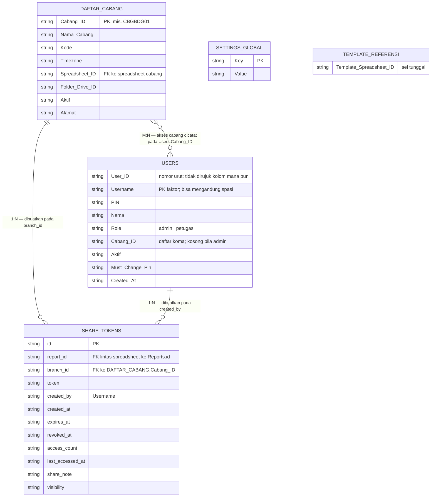
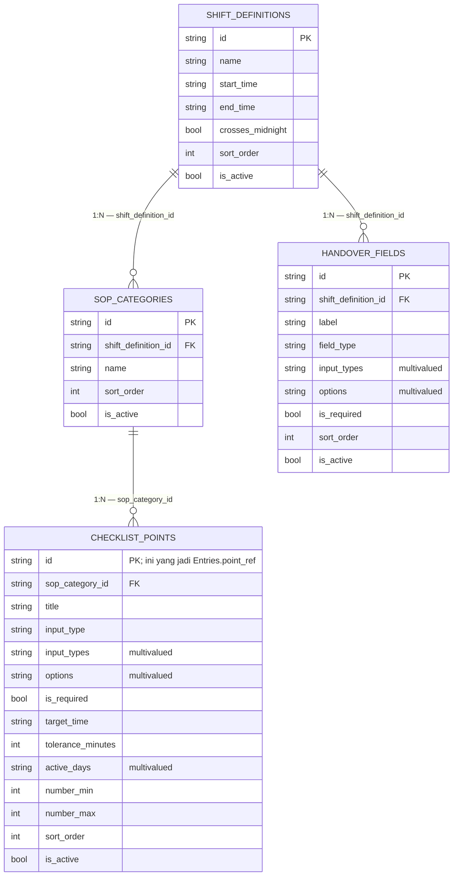
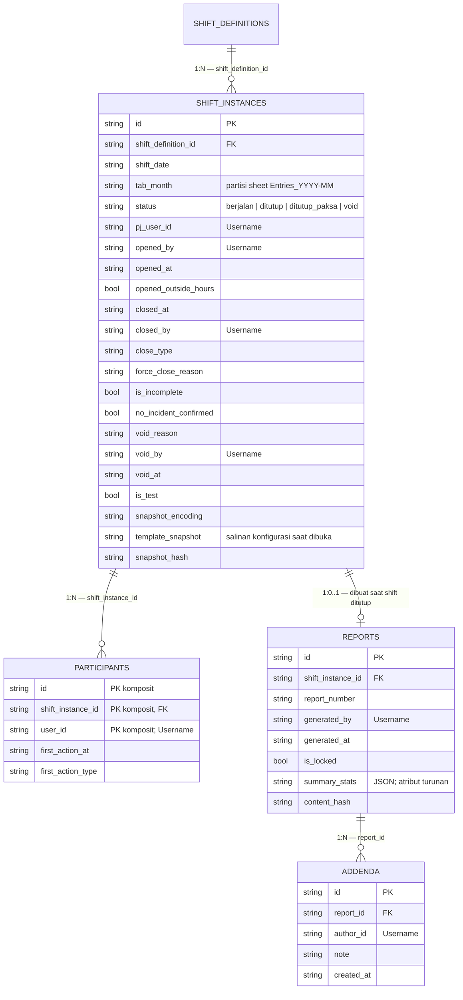
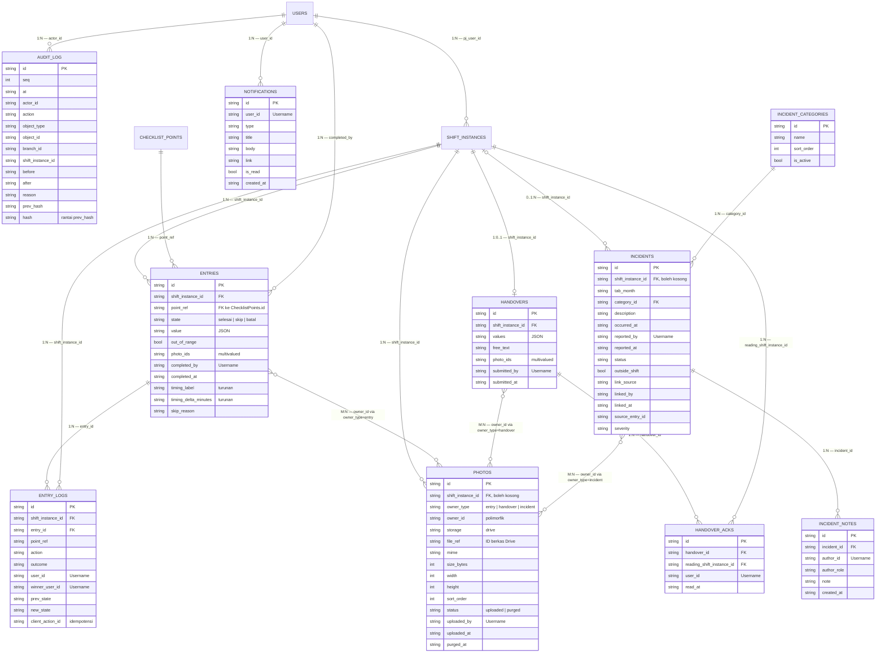

# Relasi Entitas MyCheck dalam Notasi Chen

> **Status dokumen:** ANALISIS. Semua klaim di bawah diverifikasi terhadap source
> code dan data live pada tanggal dokumen ditulis.
>
> Legenda:
>
> - **\[SAH\]** — terverifikasi di source code atau di baca dari spreadsheet live
> - **\[CATATAN\]** — interpretasi atau rekomendasi, bukan fakta implementasi

---

## 0. Catatan Penting tentang Notasi

Notasi Chen asli mendefinisikan:

| Simbol            | Bentuk                | Arti                                    |
| ----------------- | --------------------- | --------------------------------------- |
| Entitas           | persegi               | entitas kuat / lemah                    |
| Atribut           | elips                 | sederhana / komposit / multivalued     |
| Relasi            | belah ketupat         | 1:1, 1:N, M:N                          |
| Partisipasi       | garis ganda / tunggal | total / parsial                         |
| Atribut turunan   | elips putus-putus     | dihitung, bukan disimpan                |

**Mermaid tidak punya renderer Chen.** Tipe diagram yang tersedia adalah
`erDiagram`, yang mendukung entitas + atribut + relasi berlabel, tetapi:

- Grammarnya **hanya menerima token kardinalitas crow's foot**
  (`||`, `|o`, `}o`, `o{`). Bentuk Chen `"1" -- "N"` **ditolak parser** —
  sudah dicoba dan gagal di keempat diagram.
- Tidak ada simbol entitas lemah (persegi ganda).
- Tidak ada simbol atribut turunan (elips putus-putus).

Karena itu dokumen ini memakai tiga lapis supaya notasi Chen tetap terbaca:

1. **§3 — diagram Mermaid.** Garis memakai token crow's foot yang valid, dan
   **kardinalitas Chen ditulis eksplisit di dalam label relasi**, mis.
   `||--o{ ENTRIES : "1:N — shift_instance_id"`. Token dan label sengaja
   berdua: token supaya Mermaid bisa merender, label supaya pembaca
   langsung melihat bentuk Chen.
2. **§4 — tabel relasi Chen** yang memuat kardinalitas, partisipasi, dan aturan
   referensial dalam bahasa Chen yang eksplisit.
3. **§5 — klasifikasi Chen** (entitas kuat/lemah, atribut multivalued, atribut
   turunan, agregasi) yang tidak bisa digambar di Mermaid.

Pemetaan Chen → token Mermaid yang dipakai di dokumen ini:

| Chen       | Token Mermaid |
| ---------- | ------------- |
| `1`        | `\|\|`        |
| `0..1`     | `\|o`         |
| `N`        | `o{`          |
| `M`        | `\}o`         |

Keempat diagram di §3 sudah divalidasi dengan parser Mermaid (versi 11) dan
lolos parse.

---

## 1. Ruang Lingkup dan Batasan Penyimpanan \[SAH\]

Ini **bukan** database relasional. Implementasi memakai Google Sheets:

- **1 spreadsheet Registry** (global), ID dari `REGISTRY_SPREADSHEET_ID`
- **1 spreadsheet per cabang**, ditunjuk oleh `Daftar_Cabang.Spreadsheet_ID`
- Foto disimpan sebagai berkas di Google Drive; hanya metadata-nya ada di sheet

Konsekuensi yang harus dibaca sebelum memakai ERD ini:

- Tidak ada primary key, unique constraint, foreign key, transaksi, atau row lock.
- Relasi di bawah adalah **konvensi kode yang ditegakkan oleh helper aplikasi**,
  bukan oleh mesin penyimpanan.
- Sheet bulanan dipartisi berdasarkan nama (`Entries_2026-10`). Itu partisi operasional,
  bukan partisi SQL — semua baris satu entitas logis tersebar di beberapa sheet.

---

## 2. Peta Penyimpanan \[SAH\]

```
REGISTRY (1 spreadsheet: RESGISTRY_MYCHECK)
├── Daftar_Cabang        8 kolom, 1 baris
├── Users                9 kolom, 9 baris
├── Share_Tokens        12 kolom, 4 baris
├── Settings_Global      2 kolom, 7 baris
└── Template_Referensi   1 kolom, 1 baris
        │
        │ Spreadsheet_ID
        ▼
CABANG (1 spreadsheet per cabang)
├── STATIS
│   ├── ShiftDefinitions · SopCategories · ChecklistPoints · HandoverFields
│   ├── ShiftInstances · Participants · Reports · Addenda
│   ├── IncidentIndex · IncidentCategories · Notifications
│   ├── Summary* · Snapshots*          ← *skema ada, 0 file memakainya (§6)
│   └── _meta
└── BULANAN (partisi _YYYY-MM)
    └── Entries · EntryLogs · Handovers · HandoverAcks
        · Incidents · IncidentNotes · Photos · AuditLog
```

**Tidak ada kolom `branch_id` pada sheet cabang.** Konteks cabang ditentukan oleh
spreadsheet yang sedang dibuka, bukan oleh kolom di dalam baris.

---

## 3. Diagram Mermaid

### 3.1 Registry — entitas global



### 3.2 Cabang — konfigurasi template SOP



### 3.3 Cabang — operasi shift



### 3.4 Cabang — sheet bulanan



---

## 4. Tabel Relasi Chen

Kolom **Partisipasi** memakai definisi Chen: *total* = setiap entitas pasti
terlibat (garis ganda), *parsial* = boleh tidak terlibat (garis tunggal).

| # | Relasi | Entitas 1 | Entitas N | Kardinalitas | Partisipasi | Aturan referensial |
|---|--------|-----------|-----------|--------------|-------------|--------------------|
| R1 | akses cabang | DAFTAR_CABANG | USERS | M:N | total / parsial | Disimpan **denormalized** di `Users.Cabang_ID` sebagai daftar koma. Tidak ada tabel junction. |
| R2 | membuat token | DAFTAR_CABANG | SHARE_TOKENS | 1:N | parsial / total | `Share_Tokens.branch_id` |
| R3 | membuat token | USERS | SHARE_TOKENS | 1:N | parsial / total | `Share_Tokens.created_by` |
| R4 | mendefinisikan kategori | SHIFT_DEFINITIONS | SOP_CATEGORIES | 1:N | total / parsial | `SopCategories.shift_definition_id` |
| R5 | memuat poin | SOP_CATEGORIES | CHECKLIST_POINTS | 1:N | total / parsial | `ChecklistPoints.sop_category_id` |
| R6 | mendefinisikan field | SHIFT_DEFINITIONS | HANDOVER_FIELDS | 1:N | total / parsial | `HandoverFields.shift_definition_id` |
| R7 | diinstansikan | SHIFT_DEFINITIONS | SHIFT_INSTANCES | 1:N | total / parsial | `ShiftInstances.shift_definition_id` |
| R8 | diikuti | SHIFT_INSTANCES | PARTICIPANTS | 1:N | parsial / parsial | `Participants.shift_instance_id` |
| R9 | menghasilkan | SHIFT_INSTANCES | REPORTS | 1:0..1 | total / parsial | Satu laporan per shift. Dibentuk saat `close`. |
| R10 | dilampiri | REPORTS | ADDENDA | 1:N | total / parsial | `Addenda.report_id` |
| R11 | diisi | SHIFT_INSTANCES | ENTRIES | 1:N | parsial / parsial | `Entries.shift_instance_id` |
| R12 | menjawab | CHECKLIST_POINTS | ENTRIES | 1:N | parsial / parsial | `Entries.point_ref` = `ChecklistPoints.id` |
| R13 | mencatat aksi | ENTRIES | ENTRY_LOGS | 1:N | total / parsial | `EntryLogs.entry_id` |
| R14 | mencatat aksi | SHIFT_INSTANCES | ENTRY_LOGS | 1:N | parsial / parsial | `EntryLogs.shift_instance_id` (denormalized) |
| R15 | menyerahkan | SHIFT_INSTANCES | HANDOVERS | 1:0..1 | total / parsial | Satu handover penutup per shift. |
| R16 | dibaca | HANDOVERS | HANDOVER_ACKS | 1:N | total / parsial | `HandoverAcks.handover_id` |
| R17 | dibaca pada shift | SHIFT_INSTANCES | HANDOVER_ACKS | 1:N | parsial / parsial | `HandoverAcks.reading_shift_instance_id` |
| R18 | mencatat | SHIFT_INSTANCES | INCIDENTS | 0..1:N | parsial / parsial | `shift_instance_id` boleh kosong bila `outside_shift` |
| R19 | dikategorikan | INCIDENT_CATEGORIES | INCIDENTS | 1:N | parsial / parsial | `Incidents.category_id` |
| R20 | didokumentasikan | INCIDENTS | INCIDENT_NOTES | 1:N | total / parsial | `IncidentNotes.incident_id` |
| R21 | dilampiri | (ENTRIES ∪ HANDOVERS ∪ INCIDENTS) | PHOTOS | M:N | parsial / parsial | **Polimorfik** — lihat §5.3 |
| R22 | diberi tahu | USERS | NOTIFICATIONS | 1:N | parsial / parsial | `Notifications.user_id` |
| R23 | diaudit | USERS | AUDIT_LOG | 1:N | parsial / parsial | `AuditLog.actor_id` |
| R24 | memproses | SHIFT_INSTANCES | ENTRIES | 1:N | parsial / parsial | `Entries.completed_by` |
| R25 | menjadi PJ | USERS | SHIFT_INSTANCES | 1:N | parsial / parsial | `ShiftInstances.pj_user_id` |
| R26 | memakai template | TEMPLATE_REFERENSI | SHIFT_INSTANCES | 1:N | total / parsial | **Tidak disimpan sebagai kolom.** Disalin ke `template_snapshot` saat instance dibuka (§5.4) |

---

## 5. Klasifikasi Chen

### 5.1 Entitas kuat vs lemah

Chen membedakan entitas yang identitasnya mandiri dari entitas yang hanya punya
arti bersama entity induknya.

**Entitas kuat** — punya key sendiri, bisa hidup sendiri:
`DAFTAR_CABANG`, `USERS`, `SHIFT_DEFINITIONS`, `INCIDENT_CATEGORIES`,
`SHIFT_INSTANCES`, `REPORTS`, `HANDOVERS`, `INCIDENTS`, `ENTRIES`,
`SHARE_TOKENS`, `NOTIFICATIONS`, `AUDIT_LOG`.

**Entitas lemah (identifying)** — hanya bermakna sebagai bagian dari induk:

| Entitas lemah          | Induk                | Kunci komposit                                        |
| ---------------------- | -------------------- | ------------------------------------------------------ |
| `SOP_CATEGORIES`       | SHIFT_DEFINITIONS    | `id` + `shift_definition_id`                          |
| `CHECKLIST_POINTS`     | SOP_CATEGORIES       | `id` + `sop_category_id`                              |
| `HANDOVER_FIELDS`      | SHIFT_DEFINITIONS    | `id` + `shift_definition_id`                          |
| `PARTICIPANTS`         | SHIFT_INSTANCES      | `id` + `shift_instance_id` + `user_id`                 |
| `ADDENDA`              | REPORTS              | `id` + `report_id`                                    |
| `ENTRY_LOGS`           | ENTRIES              | `id` + `entry_id`                                      |
| `HANDOVER_ACKS`        | HANDOVERS            | `id` + `handover_id`                                   |
| `INCIDENT_NOTES`       | INCIDENTS            | `id` + `incident_id`                                   |

> Catatan Sheet: unik-ness kunci komposit ini **tidak ditegakkan** oleh Drive.
> `EntryLogs.id` justru dihitung deterministik dari `client_action_id` demi
> idempotensi, bukan dari ULID.

### 5.2 Atribut multivalued

Disimpan sebagai JSON/array di dalam satu sel, bukan sebagai baris terpisah:

| Entitas            | Atribut                      |
| ------------------ | ---------------------------- |
| CHECKLIST_POINTS   | `input_types`, `options`, `active_days` |
| HANDOVER_FIELDS    | `input_types`, `options`     |
| ENTRIES            | `photo_ids`, `value` (JSON)  |
| HANDOVERS          | `values` (JSON), `photo_ids` |
| SHIFT_INSTANCES    | `template_snapshot` (JSON)   |
| REPORTS            | `summary_stats` (JSON)       |
| AUDIT_LOG          | `before`, `after` (JSON)     |

### 5.3 Agregasi pada `PHOTOS` (owner_type/owner_id) \[SAH\]

`Photos` tidak menunjuk satu induk tetap. Kolom `owner_type` +
`owner_id` dipilih saat upload:

```ts
// app/api/photos/upload/route.ts:45-47
if (ownerType !== 'entry' && ownerType !== 'handover' && ownerType !== 'incident')
```

Artinya satu relasi Owner–Photo dipecah menjadi **tiga relasi terpisah** yang
bergantian aktif:

| `owner_type` | `owner_id` menunjuk ke |
| ------------ | --------------------- |
| `entry`      | `ChecklistPoints.id` — **bukan** `Entries.id` |
| `handover`   | `Handovers.id`        |
| `incident`   | `Incidents.id`        |

Konsekuensi: **tidak ada foreign key yang bisa dideklarasikan** untuk relasi
ini. Validasi hanya dilakukan runtime di route upload. Lihat §6.4.

### 5.4 "Relasi" tanpa kolom: template snapshot

`ShiftInstances.template_snapshot` adalah **salinan** konfigurasi
(`ShiftDefinitions` + `SopCategories` + `ChecklistPoints` + `HandoverFields`)
pada saat shift dibuka, dibungkus JSON, dan dipadatkan bila perlu
(`lib/db/snapshot.ts`, `lib/template-snapshot.ts`).

Konsekuensi Chen: `CHECKLIST_POINTS` → `ENTRIES` (R12) secara praktis bermula
dari **snapshot**, bukan dari baris `ChecklistPoints` terkini. Mengubah template
tidak mengubah shift yang sedang berjalan. Ini disengaja, bukan bug.

### 5.5 Atribut turunan

| Atribut                | Sumber                                   |
| ---------------------- | ---------------------------------------- |
| `Entries.timing_label` | Dihitung dari `target_time` + selisih     |
| `Entries.timing_delta_minutes` | Dihitung dari `opened_at` vs `target_time` |
| `Participants.first_action_at` | Ambil `EntryLogs` pertama |
| `Reports.summary_stats` | Dihitung saat `close`                     |
| `AuditLog.seq`, `hash` | Rantai `prev_hash` → `hash`               |

---

## 6. Temuan Akurasi Skema \[SAH\]

Bagian ini memuat hal yang **tidak sesuai pembacaan spontan** dari nama kolom.
Semua diverifikasi ke source code dan ke data live.

### 6.1 Semua kolom aktor berisi `Username`, bukan `User_ID`

```ts
// lib/api-auth.ts:69-71
user: {
  id: session.username,     // ← id = USERNAME
  name: session.nama,
  username: session.username,
```

Akibatnya kolom berikut **tidak pernah** berisi `Users.User_ID`:

`Participants.user_id`, `EntryLogs.user_id`, `EntryLogs.winner_user_id`,
`Entries.completed_by`, `Handovers.submitted_by`, `HandoverAcks.user_id`,
`ShiftInstances.pj_user_id`, `ShiftInstances.opened_by`,
`ShiftInstances.closed_by`, `ShiftInstances.void_by`,
`Reports.generated_by`, `Addenda.author_id`, `Incidents.reported_by`,
`Incidents.linked_by`, `IncidentNotes.author_id`, `Photos.uploaded_by`,
`Notifications.user_id`, `AuditLog.actor_id`, `Share_Tokens.created_by`.

Konsekuensi: **tidak ada satu pun relasi yang benar-benar menunjuk
`Users.User_ID`**. Kolom `User_ID` sendiri berisi angka urut sederhana
(`"1"`, `"2"`, `"3"`, …) dan tidak dirujuk kolom mana pun — jadi praktis
tidak terpakai sebagai kunci.

### 6.2 `Username` bukan kunci yang aman

`Username` dapat mengandung spasi. Data live:

```
Username = "Nurul Hilma"
```

Akibatnya `Username` tidak memenuhi syarat identifier yang aman untuk nama berkas
dan untuk URL. Ini relevan langsung untuk
[`PHOTO-EVIDENCE-DRIVE.md`](PHOTO-EVIDENCE-DRIVE.md) §7.1, yang karena itu
wajib menyanitasi username sebelum dipakai di nama berkas.

### 6.3 Kardinalitas R1 ditentukan role, bukan oleh data

`USERS.Cabang_ID` tidak otoritatif untuk admin:

```ts
// lib/api-auth.ts:56-62
if (session.role === 'admin') {
  branchIds = cabangs.map((c) => c.Cabang_ID);   // semua cabang
}
```

Dan saat admin disimpan, kodenya memaksa kosong:

```ts
// app/api/admin/users/[id]/route.ts:98-99
// Admin implicitly punya akses ke semua cabang; simpan kosong.
updates['Cabang_ID'] = effectiveRole === 'admin' ? '' : branchIds.join(',');
```

Namun **data live tidak konsisten**: akun admin `dea` masih punya
`Cabang_ID = "CBGBDG01"`. Jadi relasi R1 untuk admin bisa terbaca "1 cabang"
dalam data, padahal akses efektifnya semua cabang. Aturan pembacaan yang benar:
**untuk admin, abaikan `Users.Cabang_ID` dan pakai seluruh daftar cabang.**

### 6.4 `Photos.owner_id` untuk `entry` menunjuk `ChecklistPoints.id`

Bukan `Entries.id`:

```ts
// lib/db/snapshot.ts:88
point_ref: asStr(p['id']),        // id dari ChecklistPoints
```

Route upload memvalidasinya terhadap snapshot, bukan terhadap baris Entries:

```ts
// app/api/photos/upload/route.ts:153-155
const pointExists = (snapshot.categories ?? []).some((c) =>
  (c.points ?? []).some((p) => p.point_ref === ownerId)
);
```

Akibatnya satu `owner_id` bisa cocok ke banyak entry pada shift berbeda. Foto
lewat alur ini ini tidak punya relasi tegas ke satu jawaban checklist tertentu.

### 6.5 `Share_Tokens` adalah referensi lintas spreadsheet

`Share_Tokens` ada di Registry, tapi `report_id` menunjuk `Reports.id` yang ada
di spreadsheet **cabang**. Tidak ada foreign key yang mungkin ditegakkan; konsistensi
hanya dijaga karena sheet cabang tidak pernah dihapus.

### 6.6 Entitas yang dideklarasikan tetapi belum dipakai

`lib/google/branch-schema.ts` mendeklarasikan `Summary` dan `Snapshots`, tetapi:

| Sheet      | File yang memakainya |
| ---------- | ------------------- |
| `Summary`  | **0**               |
| `Snapshots` | **0**              |

Keduanya ada di template spreadsheet dan di sheet cabang, tapi tidak ada kode
yang membaca atau menulisnya. Perlakukan sebagai skema mati, bukan fitur.

---

## 7. Batas Konsistensi \[SAH\]

Yang **tidak** dijamin oleh penyimpanan, meski relasi di atas tampak tegas:

1. **Tidak ada Referential integrity.** Menghapus `ShiftDefinitions` tidak
   menghapus `SopCategories` atau `ShiftInstances` yang menunjuknya.
2. **Tidak ada transaksi lintas sheet.** Pembuatan cabang bisa menyisakan
   spreadsheet yatim di Drive bila penulisan Registry gagal.
3. **Tidak ada uniqueness.** `client_action_id` pada `EntryLogs` dihitung
   deterministik sebagai pengganti unique index, bukan sebagai constraint.
4. **Partisi bulanan bukan atomik.** Entitas logis satu (`ShiftInstances`) dibaca
   dari sheet statis, sedangkan `Entries`/`Photos`-nya dibaca dari sheet bulanan
   berdasarkan `tab_month`. Keduanya harus konsisten agar data terbaca utuh.
5. **PIN pengguna tersimpan sebagai teks biasa.** Ini risiko keamanan
   implementasi yang belum diselesaikan, bukan bagian dari skema. Jangan
   menyalin PIN ke contoh, log, atau dokumentasi.
6. **Tidak ada uji ke spreadsheet sungguhan.** Test suite memakai fake Sheets
   in-memory (`tests/helpers/fake-sheets.ts`), sehingga relasi di dokumen ini
   diverifikasi lewat source code dan baca data live — bukan lewat transaksi.

---

## 8. Dokumen Terkait

- [`DATABASE_SCHEMA.md`](DATABASE_SCHEMA.md) — daftar kolom lengkap per sheet
- [`ERD.md`](ERD.md) — ERD ringkas gaya crow's foot
- [`PHOTO-EVIDENCE-DRIVE.md`](PHOTO-EVIDENCE-DRIVE.md) — rencana pemindahan
  penyimpanan foto ke Google Apps Script
- [`AGENTS.md`](AGENTS.md) §3 dan §5 — arsitektur yang berjalan dan batasan
  konsistensi
