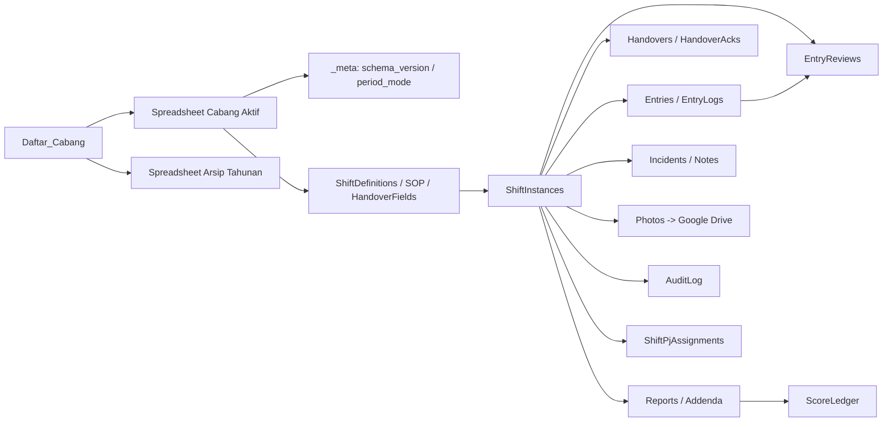

# ERD Chen MyCheck (Turunan)

Dokumen ini adalah representasi konseptual turunan dari
`PLAN/DATABASE_SCHEMA.md`, bukan sumber schema runtime.

Detail header dan aturan periode mengikuti `PLAN/DATABASE_SCHEMA.md`.
