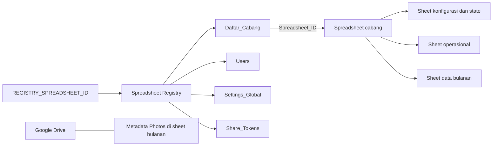
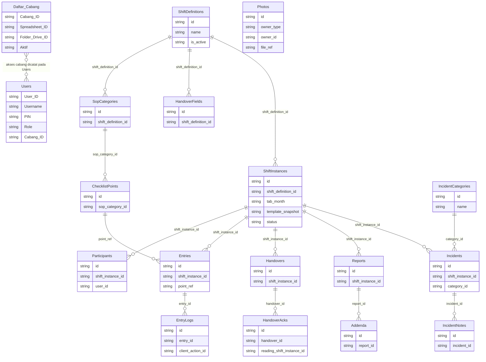

# ERD MyCheck (Google Sheets)

Dokumen ini merangkum relasi logis pada penyimpanan MyCheck. Ini **bukan ERD
database relasional**: implementasi memakai Google Sheets, sehingga panah
menandai referensi berdasarkan kolom dan bukan foreign key yang ditegakkan
database. Sumber nama/header sheet cabang adalah `lib/google/branch-schema.ts`;
akses Registry berada di `lib/google/registry.ts` dan
`lib/google/registry-admin.ts`. Detail kolom yang lebih lengkap ada di
[`DATABASE_SCHEMA.md`](DATABASE_SCHEMA.md).

## Letak data

Setiap cabang aktif menunjuk spreadsheet cabangnya melalui `Spreadsheet_ID`.
Tidak ada `branch_id` wajib pada setiap sheet cabang karena konteks cabang
ditentukan oleh spreadsheet tersebut. Foto fisik disimpan di Drive, sedangkan
referensi dan metadata disimpan pada sheet `Photos`.

## Relasi logis utama

Diagram hanya menunjukkan hubungan penting; beberapa relasi bersifat
polimorfik atau diindeks terpisah dan sengaja tidak dinyatakan sebagai
foreign key:

- `Users.Cabang_ID` menyimpan akses cabang sesuai format yang diproses oleh
  kode; daftar semua cabang untuk admin ditentukan aplikasi.
- `Entries.point_ref` mereferensikan item pada snapshot template. Template
  instance disimpan di `ShiftInstances.template_snapshot`, sehingga instance
  tetap menggambarkan konfigurasi saat dibuka.
- Sheet operasional bulanan dipilih dari `ShiftInstances.tab_month`. Nama
  seperti `Entries_2026-10` dan `Incidents_2026-10` adalah partisi operasional
  yang dikelola aplikasi, bukan partisi SQL.
- `Photos.owner_type` dan `owner_id` merujuk ke owner sesuai tipe; byte foto
  disimpan di Google Drive, bukan di sheet.
- `Share_Tokens` di Registry merujuk ke laporan cabang melalui ID cabang dan
  report ID; akses publik ditangani oleh route laporan token.

## Batas konsistensi

Google Sheets tidak menegakkan primary key, unique key, foreign key,
transaction, atau row lock. Nilai `id` dan hubungan pada gambar merupakan
konvensi kode. Pemeriksaan aplikasi dan rekonsiliasi membantu menangani
duplikasi/konflik, tetapi tidak memberi jaminan atomik database relasional.
PIN pengguna saat ini juga disimpan sebagai teks biasa; hal tersebut merupakan
risiko keamanan implementasi, bukan rekomendasi skema.
