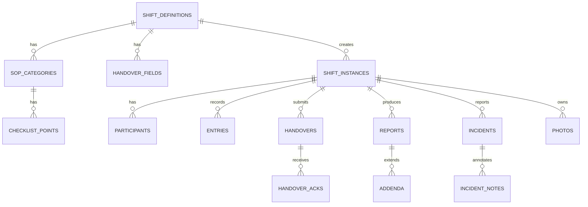

# ERD MyCheck (Turunan)

Dokumen ini diturunkan dari `PLAN/DATABASE_SCHEMA.md` dan
`lib/schema/registry.ts`. Jika berbeda, source dan schema kanonik yang
berlaku.

Google Sheets tidak menegakkan relasi, foreign key, transaksi, atau unique
constraint; panah menunjukkan relasi logis yang diperiksa aplikasi.
